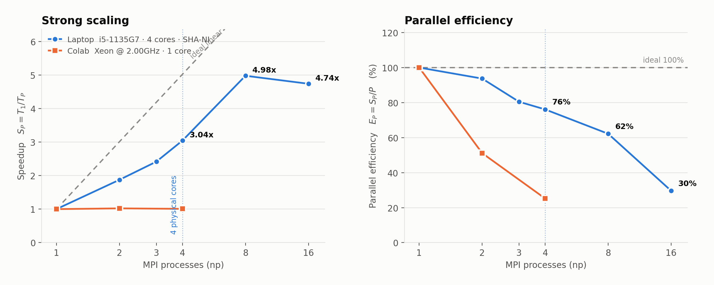
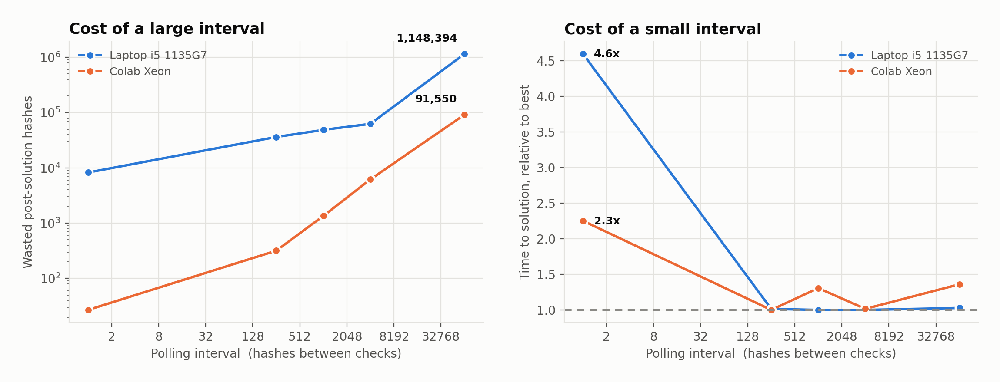

# Parallel Bitcoin Block Mining

**A C++17 project exploring SHA-256 Proof-of-Work across serial CPU, OpenMP, NVIDIA CUDA, and MPI implementations.**

This academic project models the core search performed in Bitcoin mining: find a 32-bit nonce whose double SHA-256 hash satisfies a configurable leading-zero-bit threshold. It compares four execution strategies and studies throughput, parallel scaling, termination overhead, and SHA-256 midstate precomputation.

> **Scope:** This is an educational Proof-of-Work benchmark using a fixed demonstration block header. It does not connect to the Bitcoin network, construct a production-ready block, or submit shares to a mining pool.

## Highlights

- **Four execution models:** serial C++, shared-memory CPU parallelism with OpenMP, GPU parallelism with CUDA, and multi-process parallelism with MPI.
- **Custom SHA-256 core:** double SHA-256 hashing with self-tests based on FIPS 180-4 vectors.
- **Midstate optimization:** reuse SHA-256 state for the invariant part of a block header instead of repeating the same compression work for every nonce.
- **Parallel search strategies:** OpenMP scheduling modes, CUDA grid-stride loops and atomic winner selection, and MPI nonce decomposition with configurable polling.
- **Benchmarking and analysis:** hash rate, speedup, parallel efficiency, polling overhead, and archived CSV results with scripts for generating figures.

## Benchmark highlights

The accompanying report recorded the following results on its specified test machines:

| Experiment | Recorded result | Context |
|---|---:|---|
| CUDA with midstate enabled | **981.58 million hashes/sec** | NVIDIA Tesla T4; exhaustive scan of the 32-bit nonce space while checking a 36-leading-zero-bit threshold |
| MPI strong scaling | **4.98× speedup** | 8 MPI processes on an Intel Core i5-1135G7 laptop with 4 physical CPU cores |
| MPI scaling beyond physical cores | **4.74× speedup** | 16 processes on the same laptop; lower than the 8-process result, illustrating diminishing returns |

These are recorded experiment results, not guaranteed performance on other machines. The CPU SHA-256 core was revised after some of the original CPU benchmark runs, so regenerate CPU throughput figures before making a fresh, apples-to-apples comparison. Hash rate depends on hardware, compiler flags, and the selected implementation.

## Benchmark visualizations

### MPI strong scaling and parallel efficiency

The laptop results show throughput improving as MPI processes increase, while parallel efficiency falls as the process count grows beyond the number of physical cores.



### MPI polling interval trade-off

Workers periodically check for a stop signal after a solution is found. Polling too frequently adds communication/probing overhead; polling too infrequently can leave workers doing unnecessary hashes after the search has finished.



## How it works

1. Prepare a fixed 80-byte block header and select a target difficulty in leading zero bits.
2. For each candidate nonce, place the nonce in the header and calculate `SHA256(SHA256(header))`.
3. Count the leading zero bits in the resulting 256-bit digest and check it against the target.
4. Stop when a valid nonce is found or the selected nonce range is exhausted.
5. Report the nonce/hash result and timing or throughput metrics supported by that backend.

The parallel backends distribute independent nonce candidates across threads, GPU threads, or MPI ranks. The project parallelizes the **search across nonces** rather than attempting to parallelize the dependent rounds inside one SHA-256 computation.

## Implementations

| Backend | Parallel model | Implementation details |
|---|---|---|
| Serial | One CPU thread | Reference implementation used as the baseline |
| OpenMP | Threads sharing CPU memory | Static or strided nonce scheduling, shared early-stop flag, optional midstate use |
| CUDA | NVIDIA GPU threads | Grid-stride nonce search, device-side double SHA-256, atomic coordination for the first reported solution; separate midstate-enabled source variants are included |
| MPI | Multiple processes | SPMD worker model, strided or block nonce decomposition, configurable stop-message polling and fixed-work scan mode |

## Repository layout

```text
.
├── serial/
│   └── main.cpp                   # Serial CPU baseline
├── openmp/
│   └── main.cpp                   # OpenMP CPU implementation
├── cuda/
│   ├── BitcoinCUDA.cu             # CUDA implementation
│   ├── BitcoinCUDA_custom_target.cu
│   ├── BitcoinCUDA_multi_batch_midstate_on.cu
│   └── BitcoinCUDA_multi_batch_midstate_off.cu
├── mpi/
│   ├── mpi_main.cpp               # Optimized MPI implementation
│   ├── mpi_main_baseline.cpp      # MPI baseline for comparison
│   ├── bench.sh                   # Benchmark runner
│   ├── scaling.sh                 # Strong-scaling runner
│   ├── difficulty_sweep.sh        # Difficulty sweep
│   ├── make_figures.py            # Generate benchmark plots
│   ├── data/                      # Archived benchmark CSVs and logs
│   └── fig*.png                   # Benchmark visualizations
├── core/
│   ├── sha256.h                   # Shared CPU SHA-256 core and midstate helpers
│   ├── sha256.cpp                 # Self-tests and supporting functions
│   └── README.md                  # SHA-256 implementation notes
└── mining_benchmark.csv            # Additional recorded mining runs
```

## Build and run

The backends use separate toolchains, so build the implementation you want to run. The commands below assume Linux/WSL and are run from the repository root.

### 1. Prerequisites

Install a C++17 compiler. For OpenMP and MPI, install the corresponding runtime/development tools:

```bash
sudo apt update
sudo apt install build-essential g++ openmpi-bin libopenmpi-dev
mkdir -p build
```

OpenMP is supported by GCC with `-fopenmp`. The CUDA backend additionally requires the NVIDIA CUDA Toolkit (`nvcc`) and a compatible NVIDIA GPU.

### 2. Build the CPU backends

**Serial**

```bash
g++ -O3 -march=native -std=c++17 -Icore \
    serial/main.cpp core/sha256.cpp -o build/miner_serial
```

**OpenMP**

```bash
g++ -O3 -march=native -std=c++17 -fopenmp -Icore \
    openmp/main.cpp core/sha256.cpp -o build/miner_openmp
```

Run the serial miner with a 20-leading-zero-bit threshold:

```bash
./build/miner_serial 20
```

Run OpenMP with four threads, midstate enabled (`1`), and strided scheduling:

```bash
OMP_NUM_THREADS=4 ./build/miner_openmp 20 1 stride
```

The OpenMP command-line arguments are `[difficulty] [midstate_on(1|0)] [mode(static|stride)]`.

### 3. Build and run MPI

```bash
mpic++ -O3 -march=native -std=c++17 -Icore \
    mpi/mpi_main.cpp core/sha256.cpp -o build/miner_mpi
```

Run a fixed-work throughput benchmark with four processes:

```bash
mpirun -np 4 ./build/miner_mpi \
    --mode scan --hashes 16777216 --difficulty 20
```

Run until a valid nonce is found:

```bash
mpirun -np 4 ./build/miner_mpi \
    --mode solve --difficulty 20 --poll 1024 --decomp strided
```

Use `--decomp block` to compare block decomposition, and `--poll N` to change how often workers check for stop messages. On systems that restrict MPI execution as root, follow your MPI installation's guidance; Open MPI may require `--allow-run-as-root`. `--oversubscribe` may be useful when launching more processes than available CPU slots.

### 4. Build and run CUDA

With `nvcc` installed and available on your `PATH`:

```bash
nvcc -O3 -std=c++17 cuda/BitcoinCUDA.cu -o build/miner_cuda
./build/miner_cuda
```

The basic `BitcoinCUDA.cu` example sets its difficulty in the source. The repository also contains custom-target and multi-batch midstate-on/off variants for optimization experiments; check the chosen file's arguments before running it.

## Reproducing MPI experiments

The MPI folder contains scripts, source data, and a plotting script. See [`mpi/README.md`](mpi/README.md) for all options and experiment details. After building `build/miner_mpi` from the repository root, run the scripts from `mpi/`:

```bash
bash scaling.sh ../build/miner_mpi 134217728 5
bash difficulty_sweep.sh ../build/miner_mpi 1
python3 make_figures.py
```

The scripts use fixed-work scans for throughput comparisons so early discovery of a valid nonce does not distort the hash-rate measurement. Archived data is stored in `mpi/data/`; running the scripts writes fresh experiment outputs there, so back up any data you want to preserve before rerunning them.

## Verification and interpretation

- The custom SHA-256 code includes FIPS 180-4 self-test vectors and helpers for checking midstate results against the full-hash path.
- `mpi/data/` contains recorded results, logs, and reference data used for the MPI analysis.
- **Hash rate** measures hashing throughput; **time to solution** is probabilistic and can vary depending on how soon a valid nonce is encountered.
- Reported comparisons are meaningful only when the test header, difficulty, work size, hardware, build configuration, and measurement method are taken into account.

## Limitations and future work

- The project uses a fixed demonstration header and a leading-zero-bit threshold rather than full Bitcoin network target validation via compact `nBits` encoding.
- It is not connected to the peer-to-peer network and does not perform transaction selection, production block assembly, pool communication, or block submission.
- The recorded MPI experiments use multi-process runs on individual test machines; multi-node cluster testing remains future work.
- Possible extensions include multi-node MPI deployment, hybrid MPI + CUDA execution, broader parameter sweeps, and more consistent benchmark runs across the latest implementations.

## Team contributions

The course presentation assigns the parallel backends as follows:

- **Cheah Hong Lek** — OpenMP
- **Lim Jun Yu** — CUDA
- **Mok Shao Kang** — MPI

The serial implementation provides the reference baseline for comparing the parallel approaches.

---

*BMCS3003 — Distributed Systems and Parallel Computing · 2025/2026*
